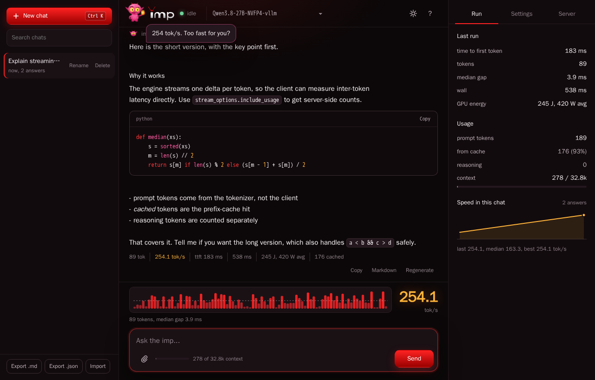

<!--
layer: L1
audience: operators
verified: 2026-09-30
commit: 0ef52509
-->

# Quickstart

From nothing to an answered completion. Everything runs in Docker; the host needs a driver, not a CUDA toolkit.

Worked example: **Qwen3.8-27B**, same as the [README](../README.md#install). This page is the long version: what to check first, what the startup log should say, the other ways in.

## Requirements

- A compute capability 12.0 GPU ([which card](#which-card)). Nothing else works; imp says so rather than fall back.
- Recent NVIDIA driver plus NVIDIA Container Toolkit (`--gpus all`).
- Disk for the model: Qwen3.8-27B in NVFP4 is 19.2 GiB, a 30B-class checkpoint ~16 GB. Converting yourself needs room for the source too.

Check the GPU is visible and free first. On WSL2 `nvidia-smi` alone is not enough: a container can hold the card without appearing in it, check `docker ps` too.

```bash
nvidia-smi
docker ps
```

### Which card

- Every compute capability 12.0 card runs the same `sm_120a` kernels ([NVIDIA list](https://developer.nvidia.com/cuda-gpus)).
- RTX 5090 D and 5090 D V2 (China market): the RTX 5090 die (GB202).
- Tested: RTX 5090; the other rows are untested.
- Weight sizes: [`MODELS.md`](MODELS.md); the KV cache takes what is left.

| VRAM | Cards | Picks (weights) |
| --- | --- | --- |
| 96 GB | RTX PRO 6000 Blackwell (Workstation, Max-Q, Server) | every 32 GB pick with a far longer context |
| 48 GB | RTX PRO 5000 Blackwell | every 32 GB pick with a longer context |
| 32 GB | **RTX 5090** (tested), RTX 5090 D, RTX PRO 4500 Blackwell | Qwen3.8-27B NVFP4 (17 GB), Qwen3.6-35B-A3B NVFP4 (18 GB), Nemotron-3-Nano-30B-A3B NVFP4 (18 GB); Qwen3.8-Flash-Next with ~62 GiB host RAM |
| 24 GB | RTX 5090 D V2, RTX PRO 4000 Blackwell | Qwen3.8-27B NVFP4 (17 GB), Qwen3-30B-A3B NVFP4 (16 GB), short context |
| 16 GB | RTX 5080, RTX 5070 Ti, RTX 5060 Ti 16 GB, RTX PRO 2000 Blackwell | Qwen3-14B NVFP4 (10 GB), Qwen3-8B Q8_0 (8.2 GB) |
| 12 GB | RTX 5070 | Qwen3-8B Q8_0 (8.2 GB), Qwen3-8B NVFP4 (5.0 GB) |
| 8 GB | RTX 5060, RTX 5060 Ti 8 GB, RTX 5050 | Qwen3-4B Q8_0 (4.0 GB), Llama-3.2-3B Q8_0 (3.2 GB) |

DGX Spark (GB10) is compute capability 12.1: no image in the default build ([`LIMITATIONS.md`](LIMITATIONS.md)).

## 1. Get a model

`stage-model.sh` needs the `imp:test` image and exits 1 without it, including on the download-only path (#1682). `make build` is what produces that tag; `docker compose build imp-server` produces `imp:latest`.

```bash
make build                                     # ~3.5 min, produces imp:test
scripts/stage-model.sh kekzle/Qwen3.8-27B-NVFP4-vllm ~/models/Qwen3.8-27B-NVFP4-vllm
```

19.2 GiB, download only: that repo is already NVFP4 (an `imp-quantize --format vllm` export - the same directory also loads in vLLM, verified on 0.27.1), so the script fetches it and stops. imp reads two formats, no conversion step for either:

- a **GGUF file** (`Qwen3-8B-Q8_0.gguf`)
- a **SafeTensors directory** with NVFP4 weights, as exported by NVIDIA Model Optimizer, llm-compressor, or `imp-quantize`

Which checkpoints load, and what each needs: [`MODELS.md`](MODELS.md).

### Converting a source that is not NVFP4 yet

The same script takes a BF16 or FP8 repo and converts it. Qwen3.8-27B needs this if you build it yourself, which is where the checkpoint above came from:

```bash
scripts/stage-model.sh Qwen/Qwen3.8-27B-FP8 ~/models/my-Qwen3.8-NVFP4
```

28.8 GiB down, ~25 minutes on the card, 18.8 GiB out. The script needs only `curl`, `jq` and Docker: `git clone` needs git-lfs and `huggingface-cli` needs Python, neither installed by the clean-host policy.

A checkpoint that loads without conversion needs no script: `--model hf://<org>/<repo>` downloads it inside the container ([`CONFIG.md`](CONFIG.md#fetching-from-hugging-face)).

Before converting it forecasts the output size and whether it fits the card: a checkpoint that would miss the card costs seconds instead of 25 minutes. Prefer an FP8 source where one exists: for Qwen3.8-27B 28.8 GiB against 51.8 GiB for BF16, costing 0.24 % perplexity (4.6262 against 4.6151 on `ppl_corpus_45k.txt`).

Models shipping only as BF16 or FP8 need the conversion to run at all: FP8 has no GEMM on `sm_120`, and a 27B in either format does not fit.

## 2. Start the server

```bash
docker run --gpus all \
  -v ~/models:/models \
  -v imp-cache:/home/imp/.cache/imp \
  -p 127.0.0.1:8080:8080 \
  ghcr.io/kekzl/imp:latest --model /models/Qwen3.8-27B-NVFP4-vllm
```

Mount the cache volume. It holds two things; the second costs VRAM rather than time:

- the transformed weights, so a second start skips the conversion: on Qwen3-14B-NVFP4, 7.9 s cold against 2.1 s warm;
- the measured library reserve. Without it the memory plan charges a 3900 MiB constant on every start, out of the KV pool. Second `docker run --rm` on the volume against the first: Qwen3.8-27B-NVFP4 plans 1930 MiB instead of 3900 and starts with 2025 KV blocks (32400 tokens) instead of 975 (15600); Qwen3-8B-Q8_0 plans 1033 MiB, KV ceiling 5617 -> 6606 blocks. The first start says so after its first forward ("library reserve MISMATCH").

A `docker run --rm` without this volume re-measures every start and never uses the answer.

Watch for these lines (the engine picked the fast paths). On Qwen3.8-27B:

```
CUTLASS sm_120 NVFP4 weight cache: 401 tensors, 1525.78 MiB
NVFP4 LM head: quantized FP16 [248320 x 5120] -> NVFP4 (682.0 MiB), decode GEMV fast path
Resolved dispatch: attn_prefill=fa2_fp16qk attn_decode=paged_nvfp4 moe_prefill=n/a (dense) graphs=1
```

`graphs=1` is the one that matters: at `graphs=0` decode runs several times slower, see [`TROUBLESHOOTING.md`](TROUBLESHOOTING.md) before benchmarking. A MoE checkpoint prints a decode-cache line instead of `n/a (dense)`; it should read `FULL`.

One warning is expected on this model, not a fault: the LM head exceeds the graph-capture workspace cap, so **prefill** graph capture is disabled while decode capture stays on. Weights land at 18.3 GiB, leaving room for the KV cache on a 32 GB card.

This checkpoint ships a trained MTP head the default load leaves off. Adding

```bash
  --set speculative.mtp_k=1 --set speculative.ngram=false
```

buys +17-21 % single-stream decode for 0.79 GiB of VRAM. `GET /health` repeats the hint as `mtp_head_hint` whenever the head is present but unloaded; numbers, provenance and the trade: [`LIMITATIONS.md`](LIMITATIONS.md).

## 3. Ask it something

The `model` field is required, and its value is the file or directory basename. `GET /v1/models` lists what is loaded.

```bash
curl -s http://localhost:8080/v1/models | jq -r '.data[].id'
# Qwen3.8-27B-NVFP4-vllm

curl -s http://localhost:8080/v1/chat/completions \
  -H "Content-Type: application/json" \
  -d '{
        "model": "Qwen3.8-27B-NVFP4-vllm",
        "messages": [{"role": "user", "content": "Why is the sky blue?"}],
        "max_tokens": 64
      }' | jq -r '.choices[0].message.content'
```

Expected: an explanation of Rayleigh scattering, written at the single-stream rate in [README Install](../README.md#install), which carries the PROV (the embedded MTP head is taken automatically on a single-stream run).

## 4. Or use the other surfaces

**Browser.** <http://localhost:8080>: single-page chat UI, streams the answer, draws one bar per token (inter-token latency visible while the reply is written).

- Shows the usage chunk of every run: prompt tokens, prefix-cache hits, reasoning tokens, context used against the model's window.
- With a models directory the header is a picker; an unloaded entry is swapped in by the request.
- One file, no build step; served from the binary at `GET /`. Nothing leaves the browser except calls to the server.

| feature | how |
|---|---|
| conversations | sidebar: new (`Ctrl+K`), rename, delete, search; kept in the browser's `localStorage` |
| export / import | Markdown or JSON per chat; JSON import |
| system prompt | per chat, with presets |
| sampling | temperature, top_p, top_k, min_p, penalties, seed, max tokens; an empty field is not sent |
| edit, regenerate, continue | edit a user turn and resend from there; continue a `finish_reason: length` answer as a follow-up turn |
| code and math | syntax colours, language label, copy; `$..$`, `$$..$$`, `\(..\)` as Unicode math |
| images | file picker, drag and drop, paste; sent as `image_url` data URIs |
| end thinking | button while the model reasons: `POST /v1/requests/{id}/end_thinking` |
| token probabilities | `logprobs` + `top_logprobs: 5`, tokens coloured by probability, alternatives on hover |
| branch at a token | click a token, pick an alternative: a new chat continues that prefix (`continue_final_message`) |
| layer readout | `logit_lens: 5`: a grid of the top token after every layer, coloured by the sampled token's probability there |
| guidance, banned phrases | `cfg_scale` (sampling panel): follow the system message harder; `banned_strings` (one per line): rewind and resample where a phrase starts |
| structured output | `response_format` `json_object` or a pasted `json_schema`, parsed before sending |
| prompt size | draft tokens from `POST /tokenize` (skipped while `/health` reports `idle_suspended`), context bar |
| server tab | `GET /metrics` every 3 s while open: queue, KV blocks, VRAM, `imp_gpu_power_watts` when exported |
| energy per answer | `imp_gpu_energy_joules_total` read before and after: J and W avg per turn; card-wide, so concurrent work counts |
| speed history | tok/s of every answer in the chat as a sparkline |
| keys, themes, mobile | `Enter`, `Shift+Enter`, `Esc`, `/`, `?`; dark and light; drawers below 1180 and 900 px |



**Anthropic clients.** The same server answers `/v1/messages` natively. Point `ANTHROPIC_BASE_URL` at it; an Anthropic-shaped client works unchanged, no proxy.

```bash
ANTHROPIC_BASE_URL=http://localhost:8080 ANTHROPIC_API_KEY=dummy your-agent
```

**CLI, no server.** `imp-cli` runs a single prompt or an interactive chat. Command reference: [`CONFIG.md`](CONFIG.md).

**C library.** `imp.h` exposes the engine directly. Reference: [`CONFIG.md`](CONFIG.md#c-api).

## Qwen3.8-Flash-Next

Commands: [README](../README.md#quickstart-qwen38-flash-next). Weights: 25 files from `nvidia/Qwen3.8-Flash-Next-NVFP4`; imp loads 9 shards and skips `model-00010-of-00010.safetensors` and `model-fp8-mtp-ple.safetensors` (MTP and vision only).

| Item | Value |
| --- | --- |
| image | `ghcr.io/kekzl/imp:latest`, v0.46.0 or later: the Flash-Next fixes ship in v0.46.0 ([`CHANGELOG.md`](../CHANGELOG.md) `[0.46.0]`) |
| host RAM | test host 78 GiB: 74 GiB available before start, 9 GiB after load |
| load | 59.0..64.0 s to `/health` ok, 28.9..32.0 s of it pinning the host experts (was 97.7 s / 65 s before roadmap row 68, 2026-10-05) |
| KV | starts at 2025 blocks (32400 tokens), grows to 131072 tokens (8192 blocks) on a 110580-token prompt |
| batch | up to 8 requests per decode step: `max_batch_size: auto → 8` with the host experts pinned (`→ 1` on the host expert tier); the KV pool stays one 131072-token context, shared by the rows |
| long chat | 27 turns, 28 requests all `200`, up to 27241 tokens of context: decode median 64.2 tok/s, slowest turn 51.8 tok/s |

[PROV: commit=78264274 date=2026-10-01 hw=RTX5090 model=Qwen3.8-Flash-Next-NVFP4 quant=NVFP4 cuda=13.4
       path=host-resident-experts n=1 server start, 28 requests cmd=the README `docker run` with image
       imp:test-imp-longchat-87847c8b (build of 78264274) note=RAM from `free -g` before start and after /health ok]

## Next

| | |
|---|---|
| put it behind a proxy, with auth | [`DEPLOYMENT.md`](DEPLOYMENT.md) |
| which API fields actually work | [`API.md`](API.md) |
| it did something odd | [`TROUBLESHOOTING.md`](TROUBLESHOOTING.md) |
| all CLI flags and `imp.conf` keys | [`CONFIG.md`](CONFIG.md) |
