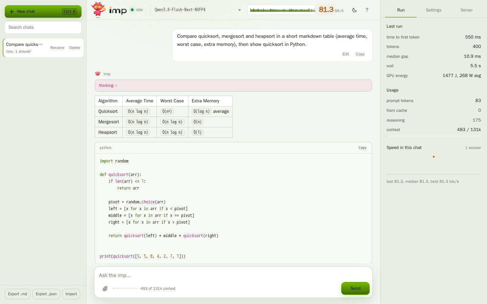
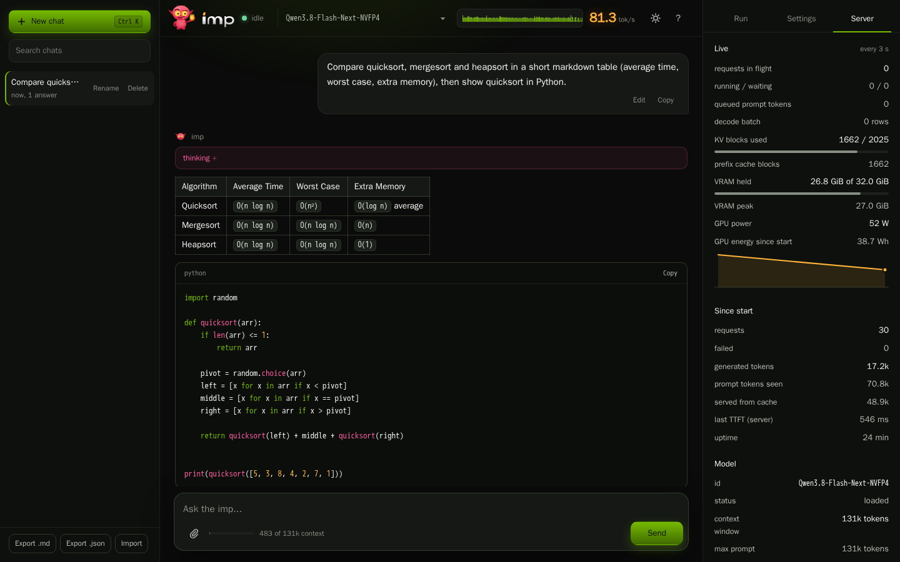
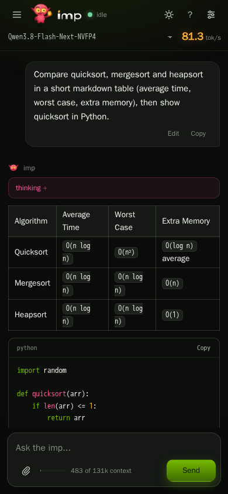

<!--
layer: L1
audience: operators
verified: 2026-11-01
commit: 216a779c
-->

# Web UI

<http://localhost:8080> on a running `imp-server`: a single-page chat that streams the answer and draws one bar per token (inter-token latency visible while the reply is written).

- Shows the usage chunk of every run: prompt tokens, prefix-cache hits, reasoning tokens, context used against the model's window.
- With a models directory the header is a picker; an unloaded entry is swapped in by the request.
- One file, no build step; served from the binary at `GET /`. Nothing leaves the browser except calls to the server.

| feature | how |
|---|---|
| conversations | sidebar: new (`Ctrl+K`), rename, delete, search; kept in the browser's `localStorage` |
| export / import | Markdown or JSON per chat; JSON import |
| system prompt | per chat, with presets |
| sampling | temperature, top_p, top_k, min_p, penalties, seed, max tokens; an empty field is not sent |
| edit, regenerate, continue | edit a user turn and resend from there; continue a `finish_reason: length` answer as a follow-up turn |
| code and math | syntax colours, language label, copy; `$..$`, `$$..$$`, `\(..\)` as Unicode math |
| markdown | headings, tables (a heading right above one stays outside it), `---` rules, `\*` escapes, links |
| live speed | header: tok/s of the running answer and one bar per token (bar height = gap to the previous token); below 900 px the number only |
| images | file picker, drag and drop, paste; sent as `image_url` data URIs |
| end thinking | button while the model reasons: `POST /v1/requests/{id}/end_thinking` |
| token probabilities | `logprobs` + `top_logprobs: 5`, tokens coloured by probability, alternatives on hover |
| branch at a token | click a token, pick an alternative: a new chat continues that prefix (`continue_final_message`) |
| layer readout | `logit_lens: 5`: a grid of the top token after every layer, coloured by the sampled token's probability there |
| guidance, banned phrases | `cfg_scale` (sampling panel): follow the system message harder; `banned_strings` (one per line): rewind and resample where a phrase starts |
| structured output | `response_format` `json_object` or a pasted `json_schema`, parsed before sending |
| prompt size | draft tokens from `POST /tokenize` (skipped while `/health` reports `idle_suspended`), context bar |
| server tab | `GET /metrics` every 3 s while open: queue, KV blocks, VRAM, `imp_gpu_power_watts` when exported |
| energy per answer | `imp_gpu_energy_joules_total` read before and after: J and W avg per turn; card-wide, so concurrent work counts; the server tab shows the total since server start |
| speed history | tok/s of every answer in the chat as a sparkline |
| keys, themes, mobile | `Enter`, `Shift+Enter`, `Esc`, `/`, `?`; dark and light; drawers below 1180 and 900 px |

  

[PROV: commit=2f7574d5 date=2026-10-18 hw=RTX5090 model=Qwen3.8-Flash-Next-NVFP4 quant=NVFP4 path=server-api
       cmd=`tools/imp-server/webui/dev/live_shots.py` n=1 note=one chat (sort table + quicksort), 81.3 tok/s, TTFT 550 ms]

GPU-less development harness: `tools/imp-server/webui/dev/`.
