<!--
layer: L2
audience: kernel-devs
verified: 2026-11-25
commit: 4d7eebf8
-->

# imp - Architecture

If the code and this document disagree, the code wins.

## Target architecture

**This is the one place in the repository that states what consumer Blackwell has and lacks.** Every other document links here; `docs_lint.py`'s forbidden-token check keeps it that way.

imp compiles for **`sm_120a` exclusively**, emitting raw SASS via direct gencode; GB203 (cc 12.0) loads the same SASS, a `compute_120f` PTX for cc 12.1 is opt-in (`IMP_DISABLE_120F_FALLBACK=OFF`). No portability layer, no second target.

| Absent on `sm_120a` | Where it exists | Consequence for imp |
|---|---|---|
| `tcgen05` async MMA | datacenter Blackwell (`sm_100`, B200) | the MMA always blocks the issuing warp; no producer/consumer pipeline around it |
| TMEM | `sm_100` | no tensor-memory accumulator ring; accumulators live in registers |
| `wgmma` | Hopper (`sm_90a` only, not `sm_100`) | tensor-core path is register-based `mma.sync`; the FA4-style warpgroup split is not expressible |

| Present on `sm_120a`, and used | Detail |
|---|---|
| NVFP4 block-scaled `mma.sync`, `kind::mxf4nvf4` | FlashAttention-2-style block scaling, not a B200 kernel design |
| FP8 MMA `kind::f8f6f4` | `f` family-feature suffix; used for attention scores |
| TMA bulk-tensor loads, including the producer-warp mainloops of the own NVFP4 tile GEMMs | the dense and grouped tiles load through `src/quant/nvfp4_gemm_tile_ptx.cuh:53 cp.async.bulk.tensor.2d` (`nvfp4_gemm_tile.cu`, `gemm_grouped_nvfp4_tile.cu`), emits `UTMALDG` (`tools/standalone/gemm_nvfp4_sm120a_tma.cu:120 UTMALDG on sm_120`); the CUTLASS TMA-WS cubin verified in #1543 left the build in #2938 |

Kernel designs published for B200 or Hopper do not port as-is; check which architecture a reported FP4 win was measured on. Deeper hardware notes, MMA shapes, measured ceilings: [`SM120.md`](SM120.md).

## Pipeline

```mermaid
flowchart LR
    subgraph L["1. Load - src/model/"]
        A["GGUF / SafeTensors loader"] --> B["WeightMap + Tokenizer + ModelConfig"]
    end
    subgraph I["2. Engine init - src/runtime/engine.cpp"]
        C["RuntimeConfig"] --> D["Upload weights + pre-dequant caches"]
        D --> E["Open T2 arena + graph-slot pool"]
        E --> F["Init KV cache (caches first, pool takes the residual)"]
        F --> G["Allocate workspaces"]
        G --> H["Warmup: capture decode CUDA graph"]
    end
    subgraph P["3. Prefill - Engine::step_prefill"]
        J["Per-chunk forward: RMSNorm to LM head"] --> K["Attention dispatcher"]
    end
    subgraph De["4. Decode - Engine::step_decode_forward"]
        M["Replay CUDA graph"] --> N["Paged attention decode"]
        N --> O["FFN + LM head GEMV"]
        O --> Q["Penalties + sampler"]
        Q --> R["Stop check"]
        R -->|continue| M
    end
    B --> C
    H --> J
    K --> M
```

Entry points, all in `include/imp/imp.h`, dispatched via `src/api/imp_api.cpp`:

| Phase | Signature |
|---|---|
| Load | `imp_model_load(path) → ImpModel` |
| Engine init | `imp_context_create(model, ImpConfig) → ImpContext` |
| Prefill | `imp_prefill_with_params(tokens, n) → status` |
| Decode | `imp_decode_step(params) → next_token` (or streaming: `imp_generate_streaming`) |

## Source directories

One row per directory under `src/`; `tools/check_arch_map.py` fails on a directory without a row. Include direction (`tools/check_layering.py`): `api > runtime > vision = audio > exec > lora > model > compute > quant > memory > core`.

| Directory | Holds |
|---|---|
| `src/api/` | the C ABI of `include/imp/`: entry points, admission, suspend, token and vision calls |
| `src/runtime/` | `Engine`: init, scheduler, prefill and decode steps, speculation, CUDA graph capture, `RuntimeConfig` |
| `src/vision/` | image towers and projectors (SigLIP/gemma4v, Qwen3-VL, InternVL, Inkling2 ViT) that write LM-ready embeddings |
| `src/audio/` | Gemma-4 audio input: WAV decode (`audio_wav.cpp`), log-mel features (`audio_features.cpp`), Conformer encoder on the GPU (`gemma4_audio_encoder.cpp`, `gemma4_audio_kernels.cu`), `AudioPipeline` (`audio_pipeline.cpp`) from bytes to embeddings |
| `src/exec/` | `GraphExecutor`: the forward pass per layer, attention and FFN dispatch, pre-dequant caches, workspaces; the Inkling forward and draft |
| `src/lora/` | activation-path adapters, no weight patching: PEFT LoRA deltas per projection (`lora_adapter.cpp`) and control vectors added after a layer (`control_vector.cpp`); set through `GraphExecutor::set_lora` / `set_control_vector` |
| `src/model/` | loaders (GGUF, SafeTensors), `WeightMap`, tokenizer, chat template, `ModelConfig`, weight upload |
| `src/compute/` | kernels that are not a weight format: attention, GEMM/GEMV, norms, RoPE, sampling, GDN, MoE routing |
| `src/quant/` | weight-format kernels and converters: NVFP4, FP8, MXFP4, GGUF dequant |
| `src/memory/` | device and host allocation: backend, T2 arena, block pool, KV cache, host tiers, the memory plan |
| `src/core/` | leaf headers every layer may include: logging, tensor, CUDA RAII, PDL, graph epoch, static-reset registry |

## Inkling path

Inkling2-Loop (`ModelArch::INKLING2`) is a private runtime inside `GraphExecutor`: the standard path embeds, norms and projects, everything between runs here.

| Part | Files | What it does |
|---|---|---|
| Branch point | `src/exec/executor_forward.cu` (`run_inkling_`), `src/exec/executor_inkling.cu` | replaces the generic layer loop: `run_inkling_` returns 0 when the Inkling branch ran every layer |
| Forward | `src/exec/inkling_forward.{h,cu}`, `inkling_forward_moe.cu`, `inkling_forward_spec.cu` | `InklingForward`: one kept sequence per slot, own K/V and conv state outside the paged KV cache |
| Kernels | `src/compute/inkling_*.cu`, `src/compute/inkling_ops.h` | attention, MoE, gate and fused building blocks: FP32 residual stream, FP16 linear inputs and outputs |
| Draft | `src/exec/inkling_draft.{h,cu}`, `inkling_draft_head.{h,cu}`, `inkling_draft_weights.cu`, `inkling_draft_policy.h` | DSpark lookahead (`mtp.safetensors`): a small dense transformer over the target's feature rows, then a recurrent Markov head |
| Weights | `src/model/inkling_weights.{h,cu}`, `src/model/inkling_loader_hooks.h` | the checkpoint on the device under the vendor tensor names (`model.llm.*`), read at engine init; the standard loader keeps embedding, final norm and LM head |
| Vision | `src/vision/inkling_vision.{h,cu}` | ViT tower (`model.visual.*`), 2x2 patch merge into one LM token |
| Engine | `src/runtime/engine_inkling.cpp` | context and slot limits; the engine prefix cache is off, the forward reuses a prefix itself |
| Graphs | `InklingForward::decode_graph_`, the draft's `graph_` | its own captured graphs, one per row count up to `kGraphRows`, each compared against `graph_epoch()` before replay; not the engine's decode graph |
| Slot identity | `src/exec/inkling_slot_map.h` (`inkling_claim_block`) | a decode row finds its slot by the first KV block id of its sequence; the KV pool holds no Inkling data, so a KV, BlockPool or scheduler change can break it (`docs/audit/AUDIT_ARCH_2026_11_24.md` D-4, #3270 fixed by #3272) |

## Components

| Component | File | Responsibility |
|---|---|---|
| GGUF loader | `src/model/gguf_loader.cpp` | `.gguf` format detection and parse |
| SafeTensors loader | `src/model/safetensors_loader.cpp` | HF directory (`config.json` + `*.safetensors`) parse |
| LLM-Compressor recipe loader | `src/model/llm_compressor_loader.cpp` | quantization recipe metadata for compressed-tensors checkpoints |
| WeightMap | `src/model/weight_map.cpp` | tensor name -> role |
| Tokenizer + chat template | `src/model/tokenizer.cpp`, `chat_template.cpp`, `jinja.cpp`, `sentencepiece_loader.cpp` | tokenization, Jinja chat templating |
| Model / ModelConfig | `src/model/model.cpp`, `src/model/model_arch.h` | parsed model object and per-arch config |
| Engine init orchestrator | `src/runtime/engine.cpp` | `Engine::init()`, delegates to 6 per-subsystem TUs (resolver, weight upload, KV cache, workspaces, scheduler, sampling/stop) |
| Runtime config | `src/runtime/config.cpp` | `imp.conf` + `--config` + `--set` |
| VRAM budget (live pass) | `src/runtime/vram_budget.cpp` | current sizing pass; shadowed by `src/memory/plan.cpp` (see `MEMORY.md`) |
| Weight upload | `src/model/weight_upload.cpp` | H2D upload, expert weights |
| Pre-dequant cache pipeline | `src/exec/executor_pre_dequant.cpp` + `pre_dequant_phase0_nvfp4_loader.cpp`, `pre_dequant_phase1_fp16_cache.cpp`, `pre_dequant_phase2_fp8_cache.cpp`, `pre_dequant_phase3_nvfp4_decode.cpp`, `pre_dequant_phase3c_mxfp4.cpp`, `pre_dequant_phase4_tensor_registry.cpp` | FP16/FP8/NVFP4/MXFP4 weight caches; `pre_dequant_phase4_tensor_registry.cpp` also does drop-source reclaim (`phase4b`) and reclaimed-VRAM second-pass FP8 (`phase4c`) |
| KV cache | `src/memory/kv_cache.cu`, `src/runtime/engine_init_resolver.cpp` | paged block pool; `kv_block_size` 16 for every model since 2026-09-07 (`kv_cache.block_size` overrides; the retired "32 when `n_kv_heads <= 4`" rule measured a 1.5-4.3 % decode loss; #1819 is the bug class of sizing off the constant instead of the resolved value) |
| CUDA graph capture/replay | `src/runtime/cuda_graph.cu`, `src/runtime/graph_eligibility.h` | decode graph capture; demotion reasons (`GraphDemotionReason`: config `never`, `debug_raw`, calibration, streaming KV, host-resident experts, no pinned sample buffer, KV pressure) |
| Prefill forward (dense) | `src/exec/executor_forward.cu` | per-layer RMSNorm -> attention -> FFN loop |
| Prefill forward (MoE) | `src/exec/executor_forward_moe.cu` | MoE top-k grouped-GEMM variant of the same loop |
| Attention dispatcher | `src/exec/executor_attention_prefill.cu`, `src/exec/executor_attention.cu` | per-layer prefill/decode kernel choice; full table: [`ATTENTION_DISPATCH.md`](ATTENTION_DISPATCH.md) |
| Decode FFN | `src/exec/executor_ffn.cu` | dp4a / mma.sync / NVFP4 GEMV variants |
| Sampling / penalties | `src/compute/sampling.cu`, `src/compute/sampling.h`, `src/exec/executor.cu` | repeat/freq/presence/DRY penalties (params in `src/runtime/request.h`); temp/top-p/top-k/min-p/typical/mirostat via `sample_greedy`, `sample_topk_topp`, `sample_mirostat_v2`, `apply_typical_p` |
| Speculative decoding | `src/runtime/engine_spec_ngram.cpp`, `src/runtime/suffix_draft.{h,cpp}`, `src/runtime/ngram_draft.h`, `src/runtime/engine_spec_mtp.cpp`, `src/compute/mtp_forward.cu` | n-gram/suffix draft and opt-in MTP head (`speculative.hybrid` gates hybrid SSM/GDN participation), batch-1 greedy only |
| Memory subsystem | `src/memory/backend.{h,cpp}` (device), `memory/host_pinned.{h,cpp}` (host); tier allocators `arena`/`block_pool`/`graph_slots`; older still-live pieces `src/memory/vram_allocator.cpp`, `src/memory/kv_cache_manager.cpp`, `src/memory/layer_offload.cpp`, `src/memory/recurrent_snapshot_store.cpp`, `src/exec/storage_planner.cpp` | tiers, allocators, planner; canonical doc [`MEMORY.md`](MEMORY.md) |
| Kernels | `src/compute/`, `src/quant/` | attention, GEMM, RMSNorm, RoPE, SwiGLU, softmax, sampling, dequant/quant |
| Constrained decoding | `src/runtime/constraint_manager.h` (`ConstraintManager`), `src/compute/gbnf_grammar.cpp` | `JsonConstrainer`, `SchemaConstrainer`, `RegexConstrainer` (shares `RegexNfa` with JSON-Schema `pattern`), `GrammarConstrainer` (GBNF); one `apply_mask(logits, vocab, stream)` contract applied via `apply_constraint_mask` in `src/exec/executor.cu`; routed through `Engine::step_constrained_pipeline` on the `needs_constrained` flag |
| Vision | `src/vision/` | SigLIP/gemma4v (fixed token count) and Qwen3-VL (dynamic, patch-budget-sized, DeepStack taps, M-RoPE); merged embeddings replace the expanded `<\|image_pad\|>` positions before layer 0 |
| Public C API | `src/api/imp_api.cpp`, `include/imp/{imp,types,error,config}.h` | ABI-stable entry points (`CONTRIBUTING.md`) |

## Known limitations

| Limitation | Affected | Detail |
|---|---|---|
| Materialized attention path (`attention_cublas_prefill`, cuBLASLt via `gemm_lt_ex.h`) allocates ~384 MiB S-matrix workspace (`attention.attn_scores_mib`) | fallback configs only (heterogeneous per-layer shapes such as Gemma-4 hd 256/512, MLA, opted-out hd=256) | FA2 is primary for hd=64 incl. learned sinks, hd=128 (#687) and hd=256 (#932); S-matrix is skipped at init on FA2-served configs (gpt-oss -378 MiB, #2716) |
| `process_diag` is a process-wide config snapshot (`src/core/process_diag.h`) | multi-`Engine` process with different diagnostics/attention-variant settings per Engine | `RuntimeConfig` itself is per-Engine; the leaf-utility diagnostics cache is seeded once per process |

Also owned by [`docs/LIMITATIONS.md`](../LIMITATIONS.md).
